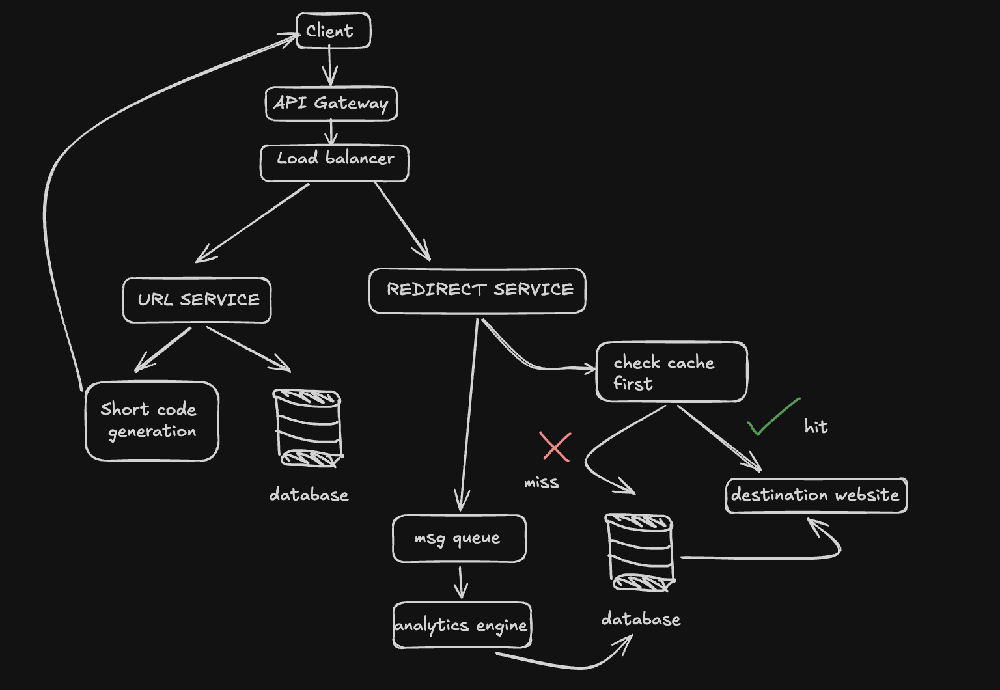

# url-shortener

Turn a long URL into a short link like `http://localhost:8080/XWqS8CG` that redirects back to the original.

Written in Go (standard library plus [Viper](https://github.com/spf13/viper) for configuration). This is a learning project: the goal is to build a shortener end to end (code, tooling, hosting and scaling) at zero cost, one stage at a time.

## Quick start

Requires Go 1.23 or newer and a free [Google Safe Browsing API key](https://developers.google.com/safe-browsing/v4/get-started).

```sh
git clone https://github.com/manankapoor23/url-shortener.git
cd url-shortener
cp .env.example .env   # then put your key in .env
go run .
```

Without a key the server still starts and existing links still redirect, but creating links returns `503`.

Open http://localhost:8080, paste a URL and click **Shorten**.

Or use the API directly:

```sh
# Create a short link
curl -X POST localhost:8080/api/shorten -d '{"url": "https://go.dev/doc/"}'
# → {"code":"XWqS8CG","short_url":"http://localhost:8080/XWqS8CG"}

# Follow it
curl -i localhost:8080/XWqS8CG
# → HTTP/1.1 302 Found
#   Location: https://go.dev/doc/
```

## How it works

**Creating a link**

1. **Validate** the URL. It is rejected if it:
   - isn't a full `http://` or `https://` URL (this blocks `javascript:` and `data:` links)
   - is longer than 2048 characters
   - contains a username or password (`https://paypal.com@evil.com` actually goes to `evil.com`)
   - points back to this shortener
   - points to `localhost` or a private network address such as `192.168.x.x`

   Whitespace is trimmed and the host is lowercased first, so `HTTPS://Example.com` and `https://example.com` count as the same URL.
2. **Check reputation** with Google Safe Browsing (malware, phishing, unwanted software). A flagged URL is rejected with `400`. If the check can't answer (no key, Google down, or slower than 3 seconds), the link is **not** created and the user gets `503`. This is *fail-closed*: never create a link that hasn't been checked.
3. **Hash** the URL with SHA-256 and turn the result into **7 Base62 characters** (`a-z`, `A-Z`, `0-9`). That gives about 3.5 trillion possible codes. Since the hash is deterministic, the same URL always gets the same code.
4. **Store** the code → URL pair in memory. If the code is already taken by a different URL (very rare), it hashes again with an attempt number, up to 5 tries.

**Following a link**

- A known code responds with **`302 Found`** and the original URL. A temporary redirect means browsers ask the server on every click instead of caching it, so links can be disabled or counted later.
- Any other code gets the same plain **`404`**, so the response never reveals which codes exist.

**Concurrency:** Go handles each request in its own goroutine. The map is guarded by a read/write mutex: many redirects can read at once, while creating a link takes an exclusive lock only around the check-and-store step. Validation, the reputation check and hashing all run before the lock, so a slow call to Google never blocks redirects.

## API

| Method | Path           | Body                     | Response                                               |
|--------|----------------|--------------------------|--------------------------------------------------------|
| `GET`  | `/`            | none                     | HTML page with the shorten form                        |
| `POST` | `/api/shorten` | `{"url": "https://..."}` | `200` `{"code", "short_url"}` · `400` `{"error"}` if invalid or flagged · `413` if body > 4 KB · `503` if the safety check is unavailable |
| `GET`  | `/{code}`      | none                     | `302` to the original URL · `404` if unknown           |

## Configuration

Settings are read from a `.env` file (see `.env.example`) or from environment variables. Environment variables win, which is how hosting platforms supply them.

| Variable                | Default                  | Purpose                                                     |
|-------------------------|--------------------------|-------------------------------------------------------------|
| `SAFE_BROWSING_API_KEY` | none                     | Google Safe Browsing key. **Secret: never commit it.**      |
| `PORT`                  | `8080`                   | Port the server listens on                                  |
| `BASE_URL`              | `http://localhost:$PORT` | Public address used to build short links (e.g. your domain) |

## Project layout

| File                | What it does                                    |
|---------------------|-------------------------------------------------|
| `main.go`           | Reads config (Viper) and starts the HTTP server |
| `handlers.go`       | Routes and HTTP handlers                        |
| `validate.go`       | URL validation rules                            |
| `reputation.go`     | Google Safe Browsing check                      |
| `shortcode.go`      | SHA-256 → Base62 code generation                |
| `store.go`          | In-memory, mutex-guarded code → URL map         |
| `static/index.html` | The web page (embedded into the binary)         |
| `*_test.go`         | Tests for each of the above                     |

## Tests

```sh
go test -race ./...
```

`-race` turns on Go's race detector, which checks the concurrent-access code for data races.

## Limitations (v1)

- **Links disappear on restart.** Everything is held in memory; there is no database yet.
- **Safety checks happen once, at creation.** A site that turns malicious later, or is too new to be on Google's list, isn't caught.
- **No rate limiting.** Anyone who can reach the server can create unlimited links.

## Roadmap

The diagram below is the full-scale design this project is working towards. v1 covers only the short-code generation and redirect parts, in a single server.



Next steps, roughly in order:

- [x] v1: shorten + redirect, input validation, in-memory storage
- [x] Check URLs against Google Safe Browsing (fail closed if the check is unavailable)
- [ ] Deploy to free hosting
- [ ] Persistent database
- [ ] Cache for redirects
- [ ] Rate limiting
- [ ] Click analytics
- [ ] Better UI
